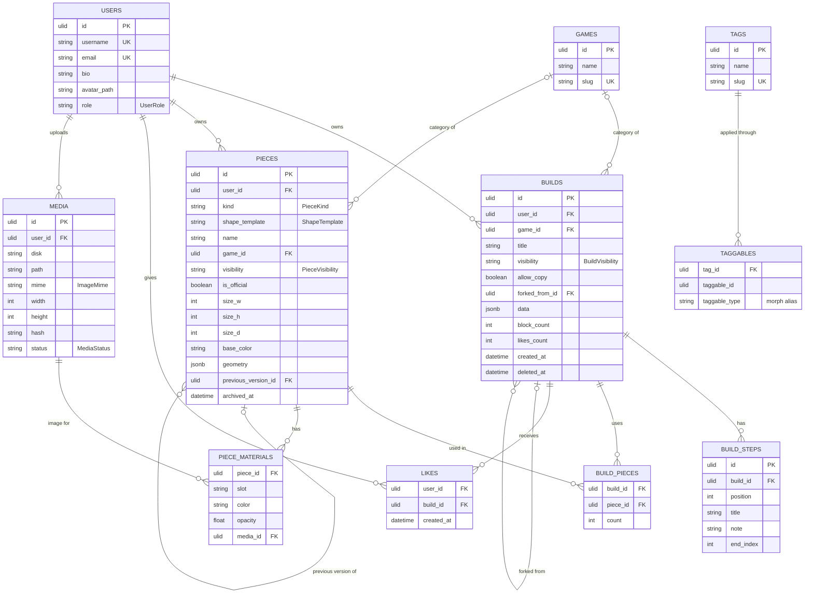

# Voxtopia - Design Document

Status: Work in Progress. 
Last Edit: 23-11-2026

## 1. What is Voxtopia
A web app to **plan voxel builds in 2D and 3D, share them, and walk others through them step by step**. Builds can be for a specific game (Minecraft, Pokopia, ...) or general. People create their own **pieces** (blocks and items), keep them private or share them, and discover builds through search, tags and likes. 

## 2. Goals
- Personal Goal: This is a project that I using to learn how to develop a new service from the begining to the end. A Full-stack project with clean architeture, test, CI, documentation and real features. Learn by doing: git workflow, testing, database design, file uploads, search, and later AI.
- Project Goal: A fully functional plataform that can help creative people and players to plan, create and execute their projects in contruction games. Every milestone ends with something working, tested and deployable.

## 3. Glossary

| Term | Meaning |
|---|---|
| **Piece** | Anything placeable. Three kinds: `cube` (fills a cell), `shape` (true 3D building piece: stairs, roofs, doors...) and `decor` (a decoration drawn as an image) |
| **Footprint** | Cells a piece occupies, `[w, h, d]`. A cube is `[1,1,1]`. Rotation swaps w and d. A piece always occupies **all** cells of its footprint, however thin it is inside |
| **Official piece** | Template piece available to everyone, owned by a system account |
| **Build** | A saved arrangement of pieces on a grid, plus optional steps |
| **Palette** | The list of distinct pieces a build uses; blocks refer to it by index |
| **Step** | A cut point in placement order: a step shows blocks `[0, end_index)` |
| **Fallback** | The color-only version of a piece shown to viewers who may not see its images |
| **Shape** | A building piece whose 3D form is generated from a template and parameters (or from custom parts) |
| **Template** | A named generator of shape geometry (stairs, slab, roof, panel, post, fence, curved block) |
| **Parts** | A list of primitives (box, wedge, cylinder, cone, profile) that together form a shape's geometry |
| **Material slot** | A named surface of a piece (e.g. `panel`, `frame`, `glass`) that takes a color and an optional image |
| **Decor** | A decoration item: a transparent image shown in its footprint |

## 4. Architecture

Laravel monolith with Inertia: one codebase, one deploy, session auth. React + TypeScript renders every page.
The editor (3D + 2D) is a client-side feature that keeps its state in Zustand until Save.

```
Browser (React + TS, three.js, Zustand)
   │  Inertia page visits / form posts (JSON on Save)
   ▼
Routes → Middleware (auth, throttle) → Controller (thin)
   → Form Request (validation) → Action (business rule) → Models / Policies
   → PostgreSQL        + Storage (images: local disk in dev, S3-compatible in prod)
   → Queue jobs (image processing now, AI later)
```
Backend layout
- `app/Http/Controllers` thin: authorize, call an Action, return a response.
- `app/Http/Requests` validation. `app/Rules` reusable rules (e.g. `ValidBuildData`).
- `app/Enums` backed string enums (see 5.1).
- `app/Actions/{Builds,Pieces,Social}` one class per use case: `SaveBuild`, `CopyBuild`, `CreatePiece`, `ToggleLike`...
- `app/Queries` read models for listing and search (`BuildSearch`).
- `app/Policies` who may do what. `app/Jobs` background work. `app/Support` small helpers.
- Output shaping through API Resources so props sent to React are explicit (and never leak private data).

Frontend layout (`resources/js`): the starter kit's `components`, `hooks`, `layouts`, `lib`, `pages`, `types`, plus our own
`features/{editor,builds,library,profile,explore}`.

Frontend stack
- **Official Laravel React starter kit** (React, TypeScript, Inertia, Tailwind, shadcn/ui). Authentication is Laravel Fortify with
  built-in login, registration, password reset, email verification and two-factor authentication (ADR 0008).
  Fortify logic lives in `app/Actions/Fortify`. No teams, no WorkOS.
- **Wayfinder** (included in the kit) generates typed route functions at build time, so a wrong route name fails the build (and CI).
- **Zustand** for editor state (grid, palette, tool, undo/redo) (ADR 0009). Everything else comes from Laravel through Inertia props.
- **three.js** via react-three-fiber and drei for 3D; Canvas 2D for the plan view.

## 5. Data model



Notes
- `TAGGABLES` is polymorphic (builds and pieces); the diagram cannot show that. The type column stores a morph alias (`build`, `piece`), never a class name.
- `game_id` is nullable everywhere: empty means "general / any game".
- Enum-typed columns show the PHP enum name in quotes (see 5.2).
- `shape_template` and `geometry` apply to `kind = shape` only. With a template, `geometry` holds its parameters; with `custom`, it holds the parts list (see 7.1). Footprint columns (`size_w/h/d`) are derived from the geometry when the piece is saved.
- `piece_materials` holds one row per material slot (color, optional opacity, optional image). Cube slots are faces; shape slots come from the template.
- Later tables: `reports`, `follows`, `saved_pieces`, `ai_generations`.
- `build_pieces` is **derived** from `builds.data` inside the same transaction as the save. The JSON is the source of truth for geometry.


### 5.1 Identifiers

- Every table we own uses a **ULID primary key** (26 characters, time-ordered, non-guessable). There is no separate `public_id`: the id is also the URL id.
- Foreign keys are ULIDs too (`foreignUlid`). Framework tables (`jobs`, `sessions`, `cache`, `migrations`) keep their own id types, but `sessions.user_id` must match `users.id`.
- Never use random UUIDv4 as a primary key (random index placement).
- Sort lists by `created_at` with `id` as the tie-breaker, and index it. Do not rely on `id` order alone.
- Packages that assume numeric user ids need checking before we add them.

### 5.2 Enums

Backed string enums in `app/Enums`, cast on the model. Stored as `string` columns with a **CHECK constraint** (not native Postgres enums, which are awkward to change).
Each enum has a mirrored TypeScript union in `resources/js/types`, and a test keeps the two lists equal.

| Enum | Column | Cases |
|---|---|---|
| `UserRole` | `users.role` | user, admin |
| `PieceKind` | `pieces.kind` | cube, shape, decor |
| `ShapeTemplate` | `pieces.shape_template` | stairs, slab, roof, panel, post, fence, curved_block, custom |
| `PieceVisibility` | `pieces.visibility` | private, public |
| `BuildVisibility` | `builds.visibility` | private, unlisted, public |
| `MediaStatus` | `media.status` | pending, approved, rejected |
| *(material slot)* | `piece_materials.slot` | defined per kind or template in code, not by a CHECK constraint (see 7.1) |
| `ImageMime` | `media.mime` | image/png, image/jpeg, image/webp |

Pieces and builds have **separate** visibility enums on purpose: a piece can never be "unlisted", and separate types make that state impossible to represent.
`games` and `tags` are tables, not enums, because they grow at runtime. `taggables.taggable_type` uses a Laravel morph map.

### 5.3 Build data format (version 1)

```json
{
  "version": 1,
  "size": [32, 16, 32],
  "palette": ["01J...ULID", "01J...ULID"],
  "blocks": [[x, y, z, paletteIndex, rotation]]
}
```

`blocks` stay in placement order (steps are cut points). The palette holds piece ids, **not** appearance.
`version` lives in the JSON only (Postgres can query it with `data->>'version'`). There is no legacy format: when the format changes, bump `version` and add a migrator.
Limits (config): max grid 64, max blocks 20,000, max palette 32, max steps 100, max builds per user 50.

## 6. Rules that matter

### R1. Pieces are immutable once used
Appearance fields (`kind`, `shape_template`, `geometry`, footprint, `base_color`, materials) cannot change once any build references the piece.
Editing appearance creates a **new version** (`previous_version_id` points to the one it replaces). Name, description, tags,
game and visibility stay editable. Deleting a used piece **archives** it (`archived_at`), so old builds still render.

### R2. Viewer-based fallback (what a viewer may see)
Every piece always has a `base_color`. When a build is shown, the server resolves each palette entry **for that viewer**:
- piece is public or official, or the viewer owns it → full descriptor (id, name, footprint, geometry, materials, image URLs)
- otherwise → fallback descriptor, which never includes image URLs, the name or the piece id:
  - cube: a flat cube in its color
  - shape from a template: the **correct geometry** in flat colors (stairs still look like stairs)
  - decor: a flat colored box in its footprint
  - custom shape: open question (geometry or bounding box), see section 14
Nothing is blocked at publish time; the author gets a notice listing private pieces and may publish them.
Decided at view time, so publishing a piece later upgrades every build that uses it. Copies inherit the fallback.
Resolution happens on the server. React never receives hidden data.
A public image can always be downloaded by anyone; the upload screen must say so.

### R3. Visibility and copying
- Build: `private` (owner only), `unlisted` (anyone with the link, not listed), `public` (listed). Private builds answer 404, not 403.
- `allow_copy` lets other users make their own editable copy (`forked_from_id` keeps the credit).
- Piece: `private`, `public`, or official.

### R4. Counters
`block_count` and `likes_count` are stored for cheap sorting. Likes are idempotent (composite key) and update the counter in the same transaction.

## 7. Pieces: kinds and rendering

| Kind | Geometry | Appearance |
|---|---|---|
| **cube** | a 1x1x1 box | slots `all`, or `top` / `bottom` / `side`, or six faces. Added in stages: color only → one image on all faces → top/side/bottom → six |
| **shape** | generated from a template + parameters, or from custom parts | one color (and optional image) per template slot |
| **decor** | a transparent PNG/WebP drawn flat in the middle of its footprint (billboard or crossed planes) | slot `sprite`; author sets the size (e.g. 1 wide x 2 high) |

Textures are small (64-128 px) and drawn without smoothing.

### 7.1 Shapes

A shape is a **list of parts**; templates are generators that turn parameters into parts, and a custom model is a hand-made list (ADR 0010).
One renderer draws all of them.

Common parameters: `size` `[w, h, d]` in cells (per-template limits), `inverted` (upside down) and `mirrored` (left/right).
Orientation in a build stays `rotation` 0-3, so the build format does not change. Flips are parameters of the piece (create "inverted stairs" as its own piece).

| Template | Variants / parameters | Material slots |
|---|---|---|
| `stairs` | type: straight, inner corner, outer corner, curved; size | `top`, `side` |
| `slab` | thickness (1/4, 1/2, 3/4 cell); size | `top`, `side` |
| `roof` | type: slope, ridge, outer corner, inner corner; size | `surface`, `side` |
| `panel` | variant: door, window, plain; size (e.g. 1x2, 1x3, 2x3); thickness; alignment (front / center / back); frame, handle, glass options | door: `panel`, `frame`, `handle`; window: `frame`, `glass`; plain: `panel` |
| `post` | thickness; height | `body` |
| `fence` | height; width; rails (0-4); top: flat or arched | `post`, `rail` |
| `curved_block` | full-height block with a concave or convex quarter-round corner; radius; size | `top`, `side` |
| `custom` | parts list written by the author (Shape Studio, M8) | author-defined |

Rules
- **Whole-cell occupancy:** a piece occupies every cell of its footprint, however thin it is inside. Two doors cannot share a cell. The existing overlap validator keeps working unchanged.
- The **server never generates geometry**. It validates parameters, derives the footprint (for templates the footprint is `size`; for custom parts every part must fit inside the declared footprint) and stores the JSON. The client generates the meshes.
- Parts format (custom): `{primitive, pos, size, rot, slot}` with primitives `box`, `wedge`, `cylinder`, `cone`, `profile` (an extruded 2D outline, needed for notches and arches because additive primitives cannot subtract). Maximum 64 parts. Position units are decided in M8 (leaning towards 1/8 cell).
- Rendering: the parts are merged into one geometry with one group per material slot; each palette piece is one `InstancedMesh` with a material array (draw calls = palette pieces x slots, with the cap of 32 pieces). Transparent slots (glass) use opacity.

### 7.2 Plan view

- Cubes: a flat tile in `base_color` (average color of the texture when there is one).
- Shapes: a small **top-down render of the 3D geometry**, generated once and cached per piece. This works for templates and custom parts alike. Roofs and stairs show their slope or steps naturally.
- Decor: the footprint is drawn as a tile tinted with `base_color` and a dashed outline. The image is drawn **once**, centered and scaled to fit (not repeated per cell). A small badge shows height (for example "x2").
- For pieces the viewer may not see (rule R2) a generic icon or the flat-color fallback is used. When cells are too small to read, only the tinted tile is drawn.

### 7.3 Piece Studio (create / edit view)

A dedicated screen with a live 3D preview next to the form, so the author sees the piece while editing. It has three modes:
- **Cube mode:** name, color, game, tags, visibility, one image slot per face.
- **Shape mode:** choose a template, adjust parameters with sliders and toggles (size, variant, flips), set a color and image per material slot.
- **Decor mode:** upload a transparent image and set its size.
- Center: 3D preview with orbit controls and optional turntable.
- Extra previews: **tiling view** (cube repeated on a 3x3 floor or wall, to judge seamless textures), **plan view**, **fallback view** (what others see if the piece is private), and a footprint grid.
- Live checks: image size and transparency, average color computed immediately.
- Save: "Save piece", or "Save as new version" when a build already uses it (rule R1).
- The Studio, the editor and the viewer draw pieces with the **same component** (one `PieceMesh`), so the preview matches what builds show.
- Milestones: M4 (cubes), M5 (shapes), M6 (decor). The **Shape Studio** (editing parts directly) comes in M8.

## 8. Discovery

Search page filters: `q` (title), `author`, `tags[]`, `game`. Sort: newest, most liked, most blocks. Paginated.
Start with SQL (indexes on `visibility + created_at`, `+ likes_count`, `+ block_count`, `game_id`; `pg_trgm` for fuzzy titles).
Adopt a search engine (Meilisearch / Typesense) only if measured need appears. Record that decision in an ADR when it happens.
Tags are lowercase slugs, capped per item, user-created.

## 9. Uploads and safety

- Validate the real file type (not the extension); allow PNG, JPEG, WebP only; **never SVG**.
- Cap file size and dimensions; re-encode with an image library to strip metadata; store under random names.
- Per-user quotas (storage and counts) and rate limits. Verified email required to upload or publish.
- `media.status` (pending / approved / rejected) plus a `reports` table and an admin hide action.


## 10. Testing strategy

| Level | Tool | Covers |
|---|---|---|
| Unit | PHPUnit | validators, footprint math, search filters, fallback resolver, enum list equals TypeScript union |
| Feature | PHPUnit (on Postgres) | permissions, visibility, limits, copy, likes, uploads |
| Frontend unit | Vitest | editor store, plan tools, undo/redo, serializer |
| End to end | Playwright | 1–2 happy paths: register → build → save → share → view |
| Static | Pint, Larastan, ESLint, `tsc` | style and types, in CI |

Rule: each feature PR includes its tests. CI must be green to merge.

## 11. Git workflow

- `main` is always deployable. Work happens on short branches (`feat/…`, `fix/…`, `docs/…`) and merges by pull request, even when working alone.
- Conventional Commits (`feat:`, `fix:`, `test:`, `docs:`, `chore:`, `refactor:`).
- One GitHub issue per unit of work; milestones M0–M9; a project board.
- Branch protection on `main`: require the CI checks.
- Tag each milestone (`v0.1.0`, ...), keep a `CHANGELOG.md`.
- Never commit secrets. Keep `.env.example` current. Use the GitHub noreply email for commits.
- Definition of done: tests added, CI green, docs/ADR updated if a decision changed, no TODO without an issue.

## 12. Milestones

| # | Milestone | Done when |
|---|---|---|
| M0 | Foundations | Repo, Docker + Postgres, CI, auth, layout, docs in place |
| M1 | Pieces + editor parity | Official color cubes from the DB; editor, save and viewer work as in v1 (ported, in TS) |
| M2 | Sharing | Visibility, copy, profiles, likes |
| M3 | Discovery | Games, tags, search page |
| M4 | Custom cubes | Upload textures, own pieces, publish pieces, fallback rule (R2) |
| M5 | Shapes | Templates (stairs, slab, roof, panel, post, fence, curved block), parameters, flips, material slots, shape mode in the Studio, official shapes |
| M6 | Decor | Image items |
| M7 | Hardening | Moderation, quotas, S3 storage, thumbnails, deploy |
| M8 | Shape modeler | Users assemble their own parts (box, wedge, cylinder, cone, profile) |
| M9 | AI | Photo → shape plan → build, using cubes and shapes |